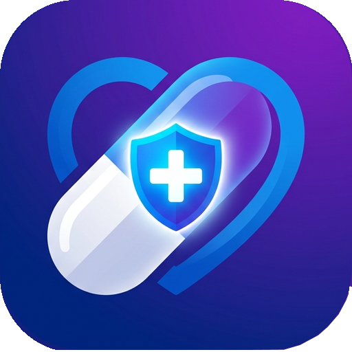
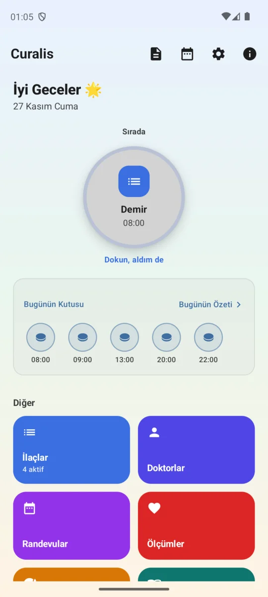
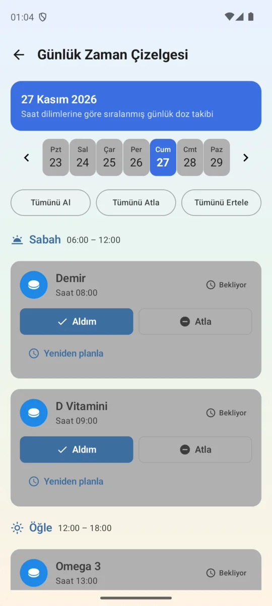
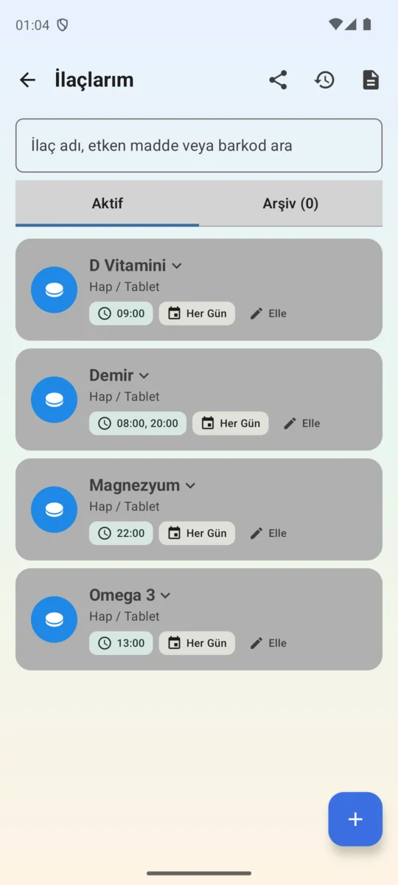
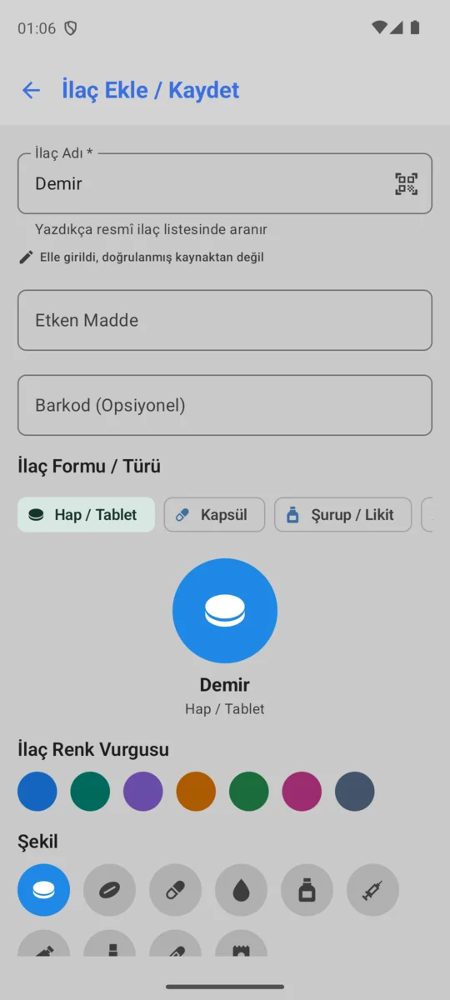
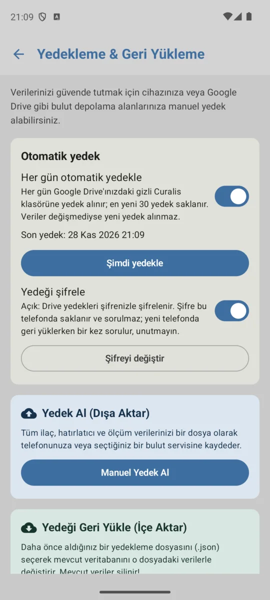
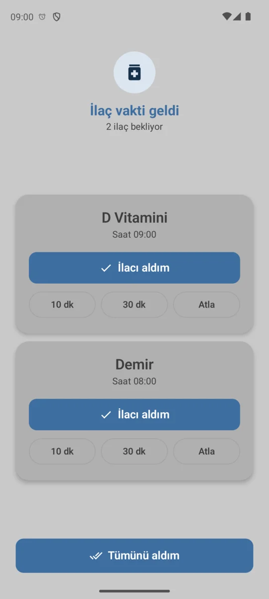

<h1 align="center">
   Curalis
</h1>

<p align="center">
  <b>English</b> · <a href="README.tr.md">Türkçe</a>
</p>

<p align="center">
  <a href="https://github.com/gokcank/Curalis/releases/latest"></a>
  
  
  
  
</p>

<p align="center">
  
</p>

**Curalis** is a local-first medication and personal health tracker for Android. It reminds you of your doses,
keeps track of what you took, and stores your medications, appointments, doctors and measurements on your phone.
Cloud backup is optional. The app is available in Turkish and English.

Curalis is distributed as an APK on GitHub; it is not on Google Play.

---

## Screenshots

<p align="center">
  
  
  
</p>
<p align="center">
  
  
  
</p>

<p align="center">*Turkish interface, sample data.*</p>

---

## Install

1. Open the [latest release](https://github.com/gokcank/Curalis/releases/latest) on your phone and download the
   `Curalis-x.y.z.apk` file.
2. Open the file and allow installing apps from this source when Android asks.
3. Updates: install the new APK over the old one. Your data is kept.

After the first start, turn on **automatic backup** in *Settings → Backup & Restore* and write down the backup
password. You need it to open your backups on a new phone.

---

## Features

**Reminders**
- Exact-time reminders with a full-screen alarm, also on the lock screen. Take, snooze or skip from the notification.
- Daily, specific weekdays, every X days, or as needed. Time changes take effect from today or from tomorrow.
- Repeat reminders for an unanswered dose (count and interval adjustable); afterwards the dose counts as missed.
- Choice of reminder sound, optional spoken reminder, optional morning and evening summaries.
- Three lock-screen privacy levels: full, limited (no medication names), hidden.
- Warnings when reminders cannot work (notification, exact-alarm or battery permission missing), a troubleshooting
  screen, and a notice for doses missed while the phone was off.

**Medications**
- Built-in offline dictionary of 22,126 medications from the Turkish Medicines and Medical Devices Agency (TİTCK);
  search by name or active ingredient, Turkish characters in any case.
- Fill a medication by scanning the barcode or the 2D DataMatrix code on its box; the expiry date is read from the
  2D code.
- Form, meal instruction, color and shape icon per medication; treatment duration; archive.
- Stock tracking: every taken dose lowers the stock, a low-stock warning, "add a box" shortcut, stock history.

**Tracking and reports**
- Daily timeline, home-screen widget, monthly adherence calendar and adherence charts (late doses count half).
- Measurements (blood pressure, blood glucose, weight, temperature, pulse, oxygen saturation), symptoms and daily notes.
- Doctors, appointments with reminders, emergency contact (picked from your contacts without contacts permission).
- PDF report of medications and adherence to share with your doctor; share the medication list as text.

**Privacy and data safety**
- Data stays on the phone. No account, no ads, no analytics or tracking libraries.
- Optional app lock with a PIN or biometrics; a forgotten PIN can be reset with the phone's own screen lock.
- Encrypted backups (password-protected): manual export, daily automatic backup to a folder you choose, and optional
  Google Drive backup to a hidden app folder. The 30 newest automatic backups are kept.
- If the database file is ever damaged, a copy is kept before anything is deleted.

See [CHANGELOG.md](CHANGELOG.md) for the changes in each release.

---

## Architecture and tech stack

Clean architecture with one Compose screen and ViewModel per feature:

```text
UI (Jetpack Compose, Material 3)
      │
ViewModel (StateFlow)
      │
Use cases (framework-independent business logic)
      │
Repositories
 ┌────┴───────────────┬──────────────────────┐
Room database   TİTCK dictionary (SQLite)   Backup targets (folder, Google Drive)
```

- **Language:** Kotlin, Coroutines, Flow
- **UI:** Jetpack Compose, Material 3, Glance (widget)
- **Dependency injection:** Hilt
- **Storage:** Room; Android Keystore for the stored backup password
- **Scheduling:** AlarmManager (exact alarms), WorkManager
- **PDF:** Android `PdfDocument`
- **Barcode:** Google Play services code scanner (no camera permission)
- **Cloud (optional):** Google Identity Authorization API, Google Drive REST API (`appDataFolder`)

Developer documentation: [docs/index.md](docs/index.md). Architecture decisions: [docs/adr/](docs/adr/).

---

## Build

Requirements: JDK 17, Android SDK 36 (min SDK 26).

```bash
git clone git@github.com:gokcank/Curalis.git
cd Curalis

./gradlew assembleDebug                 # debug APK
./gradlew test lintDebug                # unit tests and lint

# Install on one device (find its serial with `adb devices`)
adb -s <serial> install -r app/build/outputs/apk/debug/app-debug.apk
```

A signed release build (`./gradlew assembleRelease`) reads its signing settings from `local.properties`; without
them the build still works.

---

## Privacy and medical disclaimer

- **Privacy:** Curalis does not collect, track or sell your health data. Your data stays on your phone unless you
  turn on the optional Google Drive backup. See the [privacy policy](PRIVACY_POLICY.md).
- **Medical disclaimer:** Curalis is **not** a medical device and does not give medical advice, diagnosis or
  treatment or dosage recommendations. Medication data comes from the TİTCK dictionary or from what you enter.
  Always follow your doctor or pharmacist.

---

## License

Copyright © 2026 gokcank. All rights reserved. See [LICENSE](LICENSE).

The source code is public for reading only. Using, copying, modifying or distributing it requires prior written
permission. Versions up to and including 1.8.0 were published under the MIT License.
