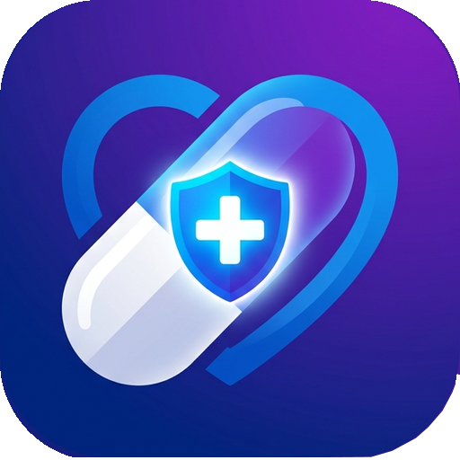

<h1 align="center">
   Curalis
</h1>

<p align="center">
  <a href="README.md">English</a> · <b>Türkçe</b>
</p>

<p align="center">
  <a href="https://github.com/gokcank/Curalis/releases/latest"></a>
  
  
  
  
</p>

<p align="center">
  
</p>

**Curalis**, Android için verileri telefonda tutan bir ilaç ve kişisel sağlık takip uygulamasıdır. Dozlarınızı
hatırlatır, neyi ne zaman aldığınızı kaydeder; ilaçlarınızı, randevularınızı, doktorlarınızı ve ölçümlerinizi
telefonunuzda saklar. Bulut yedeği isteğe bağlıdır. Uygulama Türkçe ve İngilizce kullanılabilir.

Curalis, GitHub üzerinden APK olarak dağıtılır; Google Play'de yoktur.

---

## Kurulum

1. Telefonunuzda [son sürümü](https://github.com/gokcank/Curalis/releases/latest) açın ve `Curalis-x.y.z.apk`
   dosyasını indirin.
2. Dosyayı açın; Android sorarsa bu kaynaktan uygulama yüklemeye izin verin.
3. Güncelleme: Yeni APK'yı eskisinin üzerine kurun. Verileriniz korunur.

İlk açılıştan sonra *Ayarlar → Yedekleme & Geri Yükleme* bölümünden **otomatik yedeği açın** ve yedekleme şifresini
bir yere not edin. Yedeklerinizi yeni bir telefonda açmak için bu şifre gerekir.

---

## Özellikler

**Hatırlatmalar**
- Tam saatinde hatırlatma ve kilit ekranında da açılan tam ekran alarm. Bildirimden alındı, ertele ya da atla.
- Her gün, haftanın belirli günleri, X günde bir ya da ihtiyaç halinde. Saat değişiklikleri bugünden ya da
  yarından itibaren geçerli olur.
- Yanıtlanmayan doz için tekrar hatırlatma (sayı ve aralık ayarlanabilir); ardından doz kaçırıldı sayılır.
- Hatırlatma sesi seçimi, isteğe bağlı sesli hatırlatma, isteğe bağlı sabah ve akşam özeti.
- Kilit ekranında üç gizlilik seviyesi: tam, sınırlı (ilaç adı yok), gizli.
- Hatırlatmalar çalışamayacaksa uyarı (bildirim, kesin alarm ya da pil izni eksikse), sorun giderme ekranı ve
  telefon kapalıyken kaçan dozlar için bildirim.

**İlaçlar**
- Türkiye İlaç ve Tıbbi Cihaz Kurumu (TİTCK) listesinden 22.126 ilaçlık yerleşik, çevrimdışı sözlük; ada ya da
  etken maddeye göre arama, Türkçe harflerde büyük-küçük harf farkı olmadan.
- Kutudaki barkodu ya da karekodu okutarak ilaç ekleme; son kullanma tarihi karekoddan okunur.
- Her ilaç için form, yemek talimatı, renk ve şekil simgesi; tedavi süresi; arşiv.
- Stok takibi: Alınan her doz stoğu düşürür; stok azalınca uyarı, "kutu ekle" kısayolu, stok geçmişi.

**Takip ve raporlar**
- Günlük zaman çizelgesi, ana ekran widget'ı, aylık uyum takvimi ve uyum grafikleri (geç alınan doz yarım sayılır).
- Ölçümler (tansiyon, kan şekeri, kilo, ateş, nabız, oksijen satürasyonu), belirtiler ve günlük notlar.
- Doktorlar, hatırlatmalı randevular, acil durum kişisi (rehber izni istenmeden kişilerden seçilir).
- Doktorunuzla paylaşmak için ilaç ve uyum bilgilerini içeren PDF rapor; ilaç listesini metin olarak paylaşma.

**Gizlilik ve veri güvenliği**
- Veriler telefonda kalır. Hesap yok, reklam yok, analiz ya da izleme kütüphanesi yok.
- İsteğe bağlı PIN ya da biyometrik uygulama kilidi; unutulan PIN telefonun kendi ekran kilidiyle sıfırlanabilir.
- Şifreli yedekler (parolayla korunan): elle dışa aktarma, seçtiğiniz klasöre günlük otomatik yedek ve isteğe bağlı
  olarak Google Drive'daki gizli uygulama klasörüne yedek. En yeni 30 otomatik yedek saklanır.
- Veri dosyası bir gün bozulursa, hiçbir şey silinmeden önce bir kopyası saklanır.

Her sürümdeki değişiklikler için [CHANGELOG.md](CHANGELOG.md) dosyasına bakın (İngilizce).

---

## Mimari ve teknolojiler

Her özellik için bir Compose ekranı ve bir ViewModel bulunan katmanlı (clean) mimari:

```text
Arayüz (Jetpack Compose, Material 3)
      │
ViewModel (StateFlow)
      │
Kullanım senaryoları (Android'den bağımsız iş mantığı)
      │
Depolar (repository)
 ┌────┴──────────────────┬──────────────────────┐
Room veritabanı   TİTCK sözlüğü (SQLite)   Yedek hedefleri (klasör, Google Drive)
```

- **Dil:** Kotlin, Coroutines, Flow
- **Arayüz:** Jetpack Compose, Material 3, Glance (widget)
- **Bağımlılık enjeksiyonu:** Hilt
- **Depolama:** Room; saklanan yedekleme şifresi için Android Keystore
- **Zamanlama:** AlarmManager (kesin alarmlar), WorkManager
- **PDF:** Android `PdfDocument`
- **Barkod:** Google Play hizmetleri kod tarayıcısı (kamera izni gerekmez)
- **Bulut (isteğe bağlı):** Google Identity Authorization API, Google Drive REST API (`appDataFolder`)

Geliştirici belgeleri (İngilizce): [docs/index.md](docs/index.md). Mimari kararlar: [docs/adr/](docs/adr/).

---

## Derleme

Gereksinimler: JDK 17, Android SDK 36 (en düşük SDK 26).

```bash
git clone git@github.com:gokcank/Curalis.git
cd Curalis

./gradlew assembleDebug                 # debug APK
./gradlew test lintDebug                # birim testleri ve lint

# Tek bir cihaza kurulum (seri numarasını `adb devices` ile bulun)
adb -s <seri> install -r app/build/outputs/apk/debug/app-debug.apk
```

İmzalı yayın derlemesi (`./gradlew assembleRelease`) imza ayarlarını `local.properties` dosyasından okur; bu ayarlar
olmadan da derleme çalışır.

---

## Gizlilik ve tıbbi uyarı

- **Gizlilik:** Curalis sağlık verilerinizi toplamaz, izlemez ya da satmaz. İsteğe bağlı Google Drive yedeğini
  açmadığınız sürece verileriniz telefonunuzda kalır. Ayrıntılar: [gizlilik politikası](PRIVACY_POLICY.md).
- **Tıbbi uyarı:** Curalis bir tıbbi cihaz **değildir**; tıbbi tavsiye, teşhis, tedavi ya da doz önerisi vermez.
  İlaç bilgileri TİTCK sözlüğünden ya da sizin girdiklerinizden gelir. Her zaman doktorunuza ya da eczacınıza danışın.

---

## Lisans

Telif hakkı © 2026 Gökcan. Tüm hakları saklıdır. Bkz. [LICENSE](LICENSE).

Kaynak kod yalnızca okunmak üzere herkese açıktır. Kullanmak, kopyalamak, değiştirmek ya da dağıtmak için önceden
yazılı izin gerekir. 1.8.0 dahil önceki sürümler MIT lisansıyla yayımlanmıştır.
